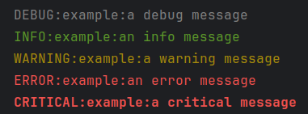

# Log formatting with colors!

[](https://pypi.org/project/colorlog/)
[](https://pypi.org/project/colorlog/)

Add colours to the output of Python's `logging` module.

- [Source on GitHub](https://github.com/borntyping/python-colorlog)
- [Package on PyPI](https://pypi.org/pypi/colorlog/)

## Status

colorlog currently requires Python 3.6 or higher. Older versions (below 5.x.x)
support Python 2.6 and above.

- colorlog 6.x requires Python 3.6 or higher.
- colorlog 5.x is an interim version that will warn Python 2 users to downgrade.
- colorlog 4.x is the final version supporting Python 2.

[colorama] is included as a dependency on Windows, where it is automatically
initialised to support colored output.

This library is over a decade old and supported a wide set of Python versions
for most of its life, which has made it a difficult library to add new features
to. colorlog 6 may break backwards compatibility so that newer features
can be added more easily, but may still not accept all changes or feature
requests. colorlog 4 might accept essential bugfixes but should not be
considered actively maintained and will not accept any major changes or new
features.

## Installation

Install from PyPI with:

```bash
pip install colorlog
```

Several Linux distributions provide official packages ([Debian], [Arch],
[Fedora], [Gentoo], [OpenSuse] and [Ubuntu]), and others have user provided
packages ([BSD ports], [Conda]).

## Usage

```python
import colorlog

handler = colorlog.StreamHandler()
handler.setFormatter(colorlog.ColoredFormatter())

logger = colorlog.getLogger('example')
logger.addHandler(handler)
```

### Arguments

`ColoredFormatter` extends [`logging.Formatter`][formatter] and accepts the
following arguments:

- `fmt` *(default=`None`)*: A format string used to output the message. If
  `None`, a default format string is selected based on `style` (e.g.
  `%(log_color)s%(levelname)s:%(name)s:%(message)s` for `%` style).
- `datefmt`, `style`, `validate`, `defaults`: see
  [`logging.Formatter`][formatter].
- `reset` *(default=`True`)*: Implicitly adds a color reset code to the
  message output, unless the output already ends with one.
- `log_colors` *(default=`None`)*: A mapping of record level names to color
  names. If `None`, `colorlog.default_log_colors` is used (see example below).
- `secondary_log_colors` *(default=`None`)*: A mapping of names to `log_colors`
  style mappings, defining additional colors that can be used in format strings.
  If `None`, an empty mapping is used.
- `stream` *(default=`None`)*: The stream being written to (e.g. `sys.stderr`).
  Used to detect whether the output is a TTY. Colors are disabled automatically
  on non-TTY streams unless `force_color` is set.
- `no_color` *(default=`False`)*: Disable color output. Can also be set via the
  `NO_COLOR` environment variable.
- `force_color` *(default=`False`)*: Force color output even on non-TTY streams.
  Takes precedence over `no_color`. Can also be set via the `FORCE_COLOR`
  environment variable.

### Color escape codes

Color escape codes can be selected based on the log records level, by adding
parameters to the format string:

- `log_color`: Return the color associated with the records level.
- `<name>_log_color`: Return another color based on the records level if the
  formatter has secondary colors configured (see `secondary_log_colors` below).

Multiple escape codes can be used at once by joining them with commas when
configuring the color for a log level (but can't be used directly in the format
string). For example, `black,bg_white` would use the escape codes for black
text on a white background.

The following escape codes are made available for use in the format string:

- `{color}`, `fg_{color}`, `bg_{color}`: Foreground and background colors.
- `bold`, `bold_{color}`, `fg_bold_{color}`, `bg_bold_{color}`: Bold/bright
  colors.
- `thin`, `thin_{color}`, `fg_thin_{color}`: Thin colors (terminal dependent).
- `reset`: Clear all formatting (both foreground and background colors).

The available color names are:

- `black`
- `red`
- `green`
- `yellow`
- `blue`
- `purple`
- `cyan`
- `white`

You can also use "bright" colors. These aren't standard ANSI codes, and
support for these varies wildly across different terminals.

- `light_black`
- `light_red`
- `light_green`
- `light_yellow`
- `light_blue`
- `light_purple`
- `light_cyan`
- `light_white`

In addition to pre-defined color names, you can use integers from 0 to 255 for
256-color support (e.g. `fg_196`, `bg_42`).

## Examples



The following code creates a `ColoredFormatter` for use in a logging setup,
using the default values for each argument.

```python
from colorlog import ColoredFormatter

formatter = ColoredFormatter(
	fmt="%(log_color)s%(levelname)s:%(name)s:%(message)s",
	datefmt=None,
    style='%',
    validate=True,
    defaults=None,
    reset=True,
	log_colors={
		"DEBUG": "white",
		"INFO": "green",
		"WARNING": "yellow",
		"ERROR": "red",
		"CRITICAL": "bold_red",
	},
	secondary_log_colors={},
    stream=None,
    no_color=False,
    force_color=False
)
```

### Using `secondary_log_colors`

Secondary log colors are a way to have more than one color that is selected
based on the log level. Each key in `secondary_log_colors` adds an attribute
that can be used in format strings (`message` becomes `message_log_color`), and
has a corresponding value that is identical in format to the `log_colors`
argument.

The following example highlights the level name using the default log colors,
and highlights the message in red for `error` and `critical` level log messages.

```python
from colorlog import ColoredFormatter

formatter = ColoredFormatter(
	"%(log_color)s%(levelname)-8s%(reset)s %(message_log_color)s%(message)s",
	secondary_log_colors={
		'message': {
			'ERROR': 'red',
			'CRITICAL': 'red'
		}
	}
)
```

### With [`dictConfig`][dictconfig]

```python
logging.config.dictConfig({
	'formatters': {
		'colored': {
			'()': 'colorlog.ColoredFormatter',
			'format': "%(log_color)s%(levelname)-8s%(reset)s %(blue)s%(message)s"
		}
	}
})
```

A full example dictionary can be found in `tests/test_colorlog.py`.

### With [`fileConfig`][fileconfig]

```ini
...

[formatters]
keys=color

[formatter_color]
class=colorlog.ColoredFormatter
format=%(log_color)s%(levelname)-8s%(reset)s %(bg_blue)s[%(name)s]%(reset)s %(message)s from fileConfig
datefmt=%m-%d %H:%M:%S
```

An instance of ColoredFormatter created with those arguments will then be used
by any handlers that are configured to use the `color` formatter.

A full example configuration can be found in `tests/test_config.ini`.

### With custom log levels

ColoredFormatter will work with custom log levels added with
[`logging.addLevelName`][addlevelname]:

```python
import logging, colorlog
TRACE = 5
logging.addLevelName(TRACE, 'TRACE')
formatter = colorlog.ColoredFormatter(log_colors={'TRACE': 'yellow'})
handler = logging.StreamHandler()
handler.setFormatter(formatter)
logger = logging.getLogger('example')
logger.addHandler(handler)
logger.setLevel('TRACE')
logger.log(TRACE, 'a message using a custom level')
```

## Tests

Tests similar to the above examples are found in `tests/test_colorlog.py`.

## Status

colorlog is in maintenance mode. I try and ensure bugfixes are published,
but compatibility a wide set of Python versions makes this a difficult
codebase to add features to. Any changes that might break backwards
compatibility for existing users will not be considered.

## Alternatives

There are some more modern libraries for improving Python logging you may
find useful.

- [structlog]
- [jsonlog]

## Projects using colorlog

GitHub provides [a list of projects that depend on colorlog][dependents].

Some early adopters included [Errbot], [Pythran], and [zenlog].

## Licence

Copyright (c) 2012-2025 Sam Clements <sam@borntyping.co.uk>

Permission is hereby granted, free of charge, to any person obtaining a copy of
this software and associated documentation files (the "Software"), to deal in
the Software without restriction, including without limitation the rights to
use, copy, modify, merge, publish, distribute, sublicense, and/or sell copies of
the Software, and to permit persons to whom the Software is furnished to do so,
subject to the following conditions:

The above copyright notice and this permission notice shall be included in all
copies or substantial portions of the Software.

THE SOFTWARE IS PROVIDED "AS IS", WITHOUT WARRANTY OF ANY KIND, EXPRESS OR
IMPLIED, INCLUDING BUT NOT LIMITED TO THE WARRANTIES OF MERCHANTABILITY, FITNESS
FOR A PARTICULAR PURPOSE AND NONINFRINGEMENT. IN NO EVENT SHALL THE AUTHORS OR
COPYRIGHT HOLDERS BE LIABLE FOR ANY CLAIM, DAMAGES OR OTHER LIABILITY, WHETHER
IN AN ACTION OF CONTRACT, TORT OR OTHERWISE, ARISING FROM, OUT OF OR IN
CONNECTION WITH THE SOFTWARE OR THE USE OR OTHER DEALINGS IN THE SOFTWARE.

[addlevelname]: https://docs.python.org/3/library/logging.html#logging.addLevelName
[arch]: https://archlinux.org/packages/extra/any/python-colorlog/
[bsd ports]: https://www.freshports.org/devel/py-colorlog/
[colorama]: https://pypi.python.org/pypi/colorama
[conda]: https://anaconda.org/conda-forge/colorlog
[debian]: https://packages.debian.org/trixie/python3-colorlog
[dependents]: https://github.com/borntyping/python-colorlog/network/dependents?package_id=UGFja2FnZS01MDk3NDcyMQ%3D%3D
[dictconfig]: http://docs.python.org/3/library/logging.config.html#logging.config.dictConfig
[errbot]: http://errbot.io/
[fedora]: https://src.fedoraproject.org/rpms/python-colorlog
[fileconfig]: http://docs.python.org/3/library/logging.config.html#logging.config.fileConfig
[formatter]: http://docs.python.org/3/library/logging.html#logging.Formatter
[gentoo]: https://packages.gentoo.org/packages/dev-python/colorlog
[jsonlog]: https://github.com/borntyping/jsonlog
[opensuse]: http://rpm.pbone.net/index.php3?stat=3&search=python-colorlog&srodzaj=3
[pythran]: https://github.com/serge-sans-paille/pythran
[structlog]: https://www.structlog.org/en/stable/
[ubuntu]: https://launchpad.net/python-colorlog
[zenlog]: https://github.com/ManufacturaInd/python-zenlog
